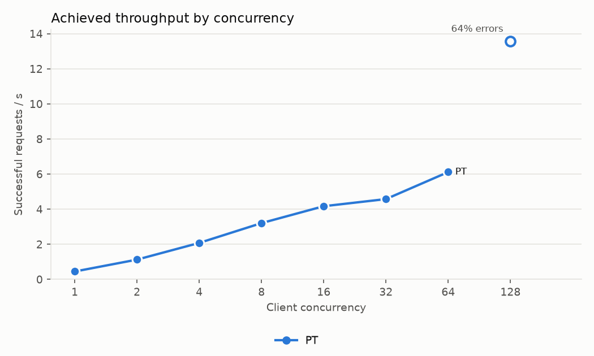
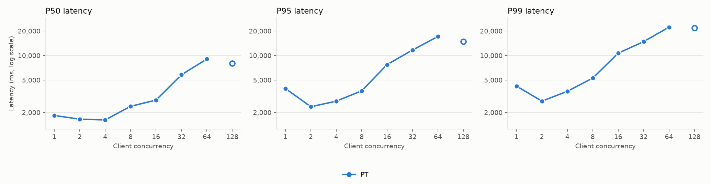
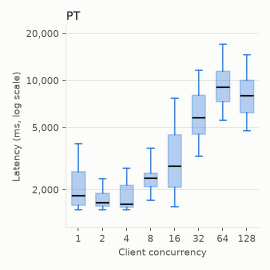
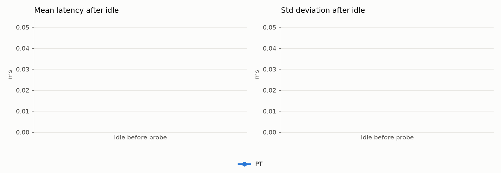

# openai/gpt-oss-120b (chat)

Run `run_fe78b6c35b14` on 2026-11-12 in https://e2-demo-field-eng.cloud.databricks.com.

| Endpoint | Peak RPS | Saturation concurrency | P50 @ sat | P95 @ sat | Errors | Warm latency | Latency after longest idle | Std after longest idle | Notes |
| --- | ---: | ---: | ---: | ---: | ---: | ---: | ---: | ---: | --- |
| PT | 6.1 | 64 | 9,064 ms | 17,119 ms | 1626 | — | — | — | C128 excluded: 64% errors (rate-limited, HTTP 429) |

## Settings

- Input: 1389 tokens, same text for every request.
- Output: up to 391 tokens; median 391 generated.
- Concurrency levels: 1, 2, 4, 8, 16, 32, 64, 128; requests per level: max(100, 20 × concurrency); 60s pause between levels; an endpoint's sweep stops after a level with more than 50% errors.
- Idle test: not run; one probe per rep after each idle duration.
- Saturation concurrency: the lowest level reaching 90% of peak RPS. Levels with more than 1% failed
  requests are excluded from peak and saturation (see Notes); their RPS counts only requests that got through.
- Custom models logged on AI env v6.

## Endpoints

- PT: `sb-gpt-oss-120b-pt` (pt, system.ai.gpt-oss-120b v1, 100 model units)

Raw data: `serving_bench_requests` and `serving_bench_summary`, filtered on `run_id = 'run_fe78b6c35b14'`.

## Charts

### Throughput

Successful requests per second at each client concurrency. A flat line means the endpoint is saturated:
more clients only queue. Hollow markers are levels with more than 1% errors; their RPS counts only the
requests that got through.

### Latency percentiles

P50/P95/P99 of successful requests at each level (log scale). Past saturation, latency grows roughly
in proportion to concurrency.

### Latency distribution

Every successful load request: box = P25–P75, line = median, whiskers = P5–P95 (log scale).

### Latency after idle

One probe per rep after each idle period, from a warm endpoint. Client-observed: this can't separate a
cold start from shared-pool load or connection setup.

## Per-level results

| Endpoint | Concurrency | Requests | RPS | P50 ms | P95 ms | P99 ms | Errors | Duration s | Note |
| --- | ---: | ---: | ---: | ---: | ---: | ---: | ---: | ---: | --- |
| PT | 1 | 100 | 0.4 | 1840 | 3938 | 4219 | 0 | 222.5 |  |
| PT | 2 | 100 | 1.1 | 1656 | 2355 | 2759 | 0 | 88.7 |  |
| PT | 4 | 100 | 2.1 | 1621 | 2758 | 3642 | 0 | 48.1 |  |
| PT | 8 | 160 | 3.2 | 2384 | 3689 | 5289 | 0 | 49.9 |  |
| PT | 16 | 320 | 4.2 | 2842 | 7748 | 10698 | 0 | 76.7 |  |
| PT | 32 | 640 | 4.6 | 5814 | 11705 | 14822 | 0 | 139.8 |  |
| PT | 64 | 1280 | 6.1 | 9064 | 17119 | 22344 | 0 | 209.2 |  |
| PT | 128 | 2560 | 13.6 | 8031 | 14810 | 21924 | 1626 | 68.8 | excluded: 64% errors (429) |
