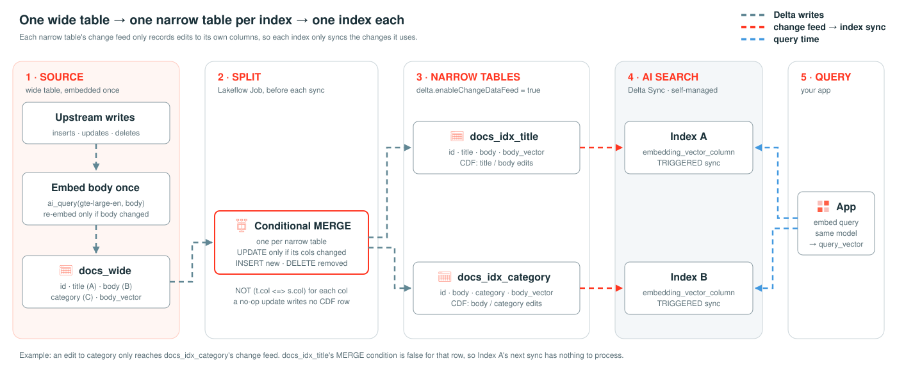

# Split one source table into one narrow table per index



## Question

If several AI Search indexes sync from one wide table, each using different columns, how do you make each index process only the changes to its own columns?

## Takeaway

**Give each index its own narrow source table, refreshed with a conditional MERGE.** Then each index's change
feed, and so its sync, only contains edits to the columns it uses. `columns_to_sync` doesn't do this: it controls
what an index stores, not which changes it processes.

Measured on 10k rows ([appendix A1](appendix/a1_test_change_isolation.py)), counting the rows in each index's source change feed after each edit:

| Edit to `docs_wide` | Rows edited | Index A (`title`, `body`) | Index B (`body`, `category`) | Comparison: index on `docs_wide`, `columns_to_sync=["title","body"]` |
|---|---|---|---|---|
| `category` only | 100 | **0** | 100 | 100 |
| `title` only | 100 | 100 | **0** | 100 |
| `body` + re-embed | 50 | 50 | 50 | 50 |

The index-side status agrees. After the `category`-only edit, the comparison index's last processed source
version moved forward even though it doesn't store `category`. Index A's didn't move, because its table had no
new changes. All three indexes still held 10,000 rows after every sync.

**Conditions and limits:**
- This was a standard endpoint with `TRIGGERED` sync. The sync status reports which source version an index has
  processed, not how many rows it processed, so the per-index row counts above come from the change feeds.
- The MERGE reads the whole source table on every run. That's cheap at this size; see
  [Scaling the split](#3-managing-the-change-feed) for large tables.
- With self-managed embeddings, nothing in the index re-embeds changed text. The source writer has to (step 1).
- Self-managed indexes only accept `query_vector`; `model_endpoint_name_for_query` doesn't change that (step 5).

## The flow, step by step

### 1. Source table: embed once, upstream

`docs_wide` holds every column any index needs, plus the embedding:

| Column | Used by |
|---|---|
| `id` | primary key, every narrow table |
| `title` (A) | Index A |
| `body` (B) | Index A and Index B; the embedded text |
| `category` (C) | Index B |
| `body_vector` | both indexes (self-managed embedding of `body`) |

With **self-managed embeddings** you compute `body_vector` yourself, here with
`ai_query('databricks-gte-large-en', body)`. Both indexes reuse the same vector, so `body` is embedded once
instead of once per index.

Keeping the vector fresh is the source writer's job, not the index's: when `body` changes, the same write must
recompute `body_vector`. `ai_query` isn't allowed inside `UPDATE` or `MERGE` (it's non-deterministic), so appendix A1
embeds the edited rows into a staging table first, then MERGEs the new text and vector into `docs_wide` together.
If a writer forgets, the indexes keep serving the old vector and nothing errors.

The wide table only needs the change data feed (CDF) if something reads its changes. In this pattern the split job
reads the full table (see step 2), so CDF on `docs_wide` is only there for the comparison index.

### 2. Split: one conditional MERGE per narrow table

`narrow_tables.py` declares the split as data:

```python
NARROW_TABLES = {
    "docs_idx_title":    ["title", "body", "body_vector"],     # Index A: A + B
    "docs_idx_category": ["body", "category", "body_vector"],  # Index B: B + C
}
```

and refreshes each narrow table from the source:

```python
changed = " OR ".join(f"NOT (t.{c} <=> s.{c})" for c in cols)  # null-safe compare
(DeltaTable.forName(spark, narrow).alias("t")
    .merge(source.select("id", *cols).alias("s"), "t.id = s.id")
    .whenMatchedUpdateAll(condition=changed)  # rows whose columns didn't change are left alone
    .whenNotMatchedInsertAll()                # new rows
    .whenNotMatchedBySourceDelete()           # rows deleted upstream
    .execute())
```

The `condition` is what makes this work. CDF tracks changes per row, not per column. An unconditional update would
rewrite every matched row and put all of them in the narrow table's change feed. With the condition, a row is only
rewritten when one of *that table's* columns differs, so editing `category` touches `docs_idx_category` and leaves
`docs_idx_title` alone.

To add an index, add a line to `NARROW_TABLES`. To give an index another column, add it to that line. That
table's schema changes, so its index has to be rebuilt; the other indexes are unaffected.

### 3. Managing the change feed

| Table | CDF | Why |
|---|---|---|
| `docs_wide` | optional | Only needed if you make the split incremental (below) or sync an index from it directly |
| each narrow table | **required** | Delta Sync indexes on standard endpoints read the change feed to find what to sync |

Each narrow table's change feed is the exact list of rows its index has to process on the next sync. You can check
it before syncing, which appendix A1 does:

```python
spark.read.option("readChangeFeed", "true").option("startingVersion", v + 1).table(narrow) \
     .where("_change_type IN ('insert', 'update_postimage', 'delete')").count()
```

**Run order:** source write → split MERGE → index sync. With `TRIGGERED` indexes, run this as one Lakeflow Job:
the MERGE task, then a task that calls `index.sync()` for each index. With `CONTINUOUS` indexes, only schedule the
MERGE; the indexes pick up narrow-table changes on their own.

**Scaling the split:** the MERGE above compares the whole source table with each narrow table on every run, which
is fine at 10k rows and at moderate sizes. For very large tables, enable CDF on `docs_wide` and drive the same
conditional MERGE from a stream over the source's change feed:

```python
(spark.readStream.option("readChangeFeed", "true").table("docs_wide")
    .where("_change_type != 'update_preimage'")
    .writeStream.foreachBatch(merge_batch_into_narrow_tables)  # same condition; handle 'delete' rows explicitly
    .option("checkpointLocation", ...).trigger(availableNow=True).start())
```

Then each run only reads the source rows that changed since the last run.

**Don't use these as the narrow layer:** an `AUTO CDC` / `apply_changes` SCD1 target, or a materialized view that
gets fully recomputed. Both can rewrite rows whose values didn't change, which puts them back in the change feed.

### 4. Indexes: one per narrow table, self-managed embeddings

```python
client.create_delta_sync_index(
    endpoint_name="split-table-vs-demo",
    index_name=f"{fq_schema}.docs_idx_title_index",
    source_table_name=f"{fq_schema}.docs_idx_title",
    primary_key="id",
    pipeline_type="TRIGGERED",
    embedding_dimension=1024,
    embedding_vector_column="body_vector",
)
```

`columns_to_sync` can be left out: the narrow table already contains only what the index needs.

### 5. Query: embed the query yourself

A self-managed index has no embedding model attached, so you embed the query with **the same model** that produced
`body_vector` and pass `query_vector`:

```python
q = spark.sql("SELECT ai_query('databricks-gte-large-en', :t) AS v", args={"t": query}).first()["v"]
index.similarity_search(query_vector=q, columns=["id", "title", "body"], num_results=5)
```

**`query_text` doesn't work on a self-managed index, and `model_endpoint_name_for_query` doesn't fix it.** [Appendix A2](appendix/a2_probe_query_model.py)
tested this three ways:

| Attempt | Result |
|---|---|
| `query_text` on a plain self-managed index | `INVALID_PARAMETER_VALUE: query vector must be specified for ... self-managed delta sync index` |
| Index created with the Python SDK, passing `model_endpoint_name_for_query` | Created without error, but the SDK drops the field: it only sends it with `embedding_source_column`. The index has no query model, and `query_text` fails with the same error |
| Index created through the REST API, with the field set on `embedding_vector_columns` | Created without error, but the API drops the field too. Same `query_text` error |

So for self-managed embeddings, the application embeds every query itself. Two things to watch:
- **Use exactly the same model** (and version) that produced `body_vector`. A different model doesn't raise an
  error, but the results get quietly worse.
- **Every query needs an embedding call.** Count that call's latency in the query path (here, a call to the
  `databricks-gte-large-en` endpoint).

## How to run

**Prerequisites:** a Unity Catalog catalog you can create schemas in, serverless notebooks/jobs, the
`databricks-gte-large-en` Foundation Model endpoint, and permission to create AI Search endpoints.

**Configuration:** each notebook has `catalog_name` (default `main`),
`schema_name` (default `split_table_vs`), and `endpoint_name` (default `split-table-vs-demo`) widgets.
Create the endpoint first if it doesn't exist:
`databricks vector-search-endpoints create-endpoint split-table-vs-demo STANDARD`.

**Run order:**

| Notebook | What it does | Expected output |
|---|---|---|
| `00_create_source` | Generates 10k synthetic docs and embeds `body` into `docs_wide` | `10000 rows in ...docs_wide` |
| `01_create_narrow_tables_and_indexes` | Creates and fills the two narrow tables, and creates Index A and Index B | Both indexes `ready` |
| `02_query_self_managed` | Embeds a query and searches each index with `query_vector`; Index B with a `category` filter | Top hits for each query |
| `99_cleanup` | Deletes the indexes and drops the schema; set `delete_endpoint=true` to remove the endpoint too | — |

`narrow_tables.py` holds the split and the helpers the notebooks import; keep it next to them.

**Appendix (optional, run after `01`):** the evidence behind the takeaway. Neither is needed to use the pattern.

| Notebook | What it does | Expected output |
|---|---|---|
| `appendix/a1_test_change_isolation` | Adds a comparison index on `docs_wide`, then edits `category`, `title`, and `body` in turn; refreshes the split; counts each index's change-feed rows; syncs | A results table where every row passes |
| `appendix/a2_probe_query_model` | Tries `model_endpoint_name_for_query` on two temporary indexes (SDK and REST), then deletes them. Takes several minutes | `query_text` fails on both |
