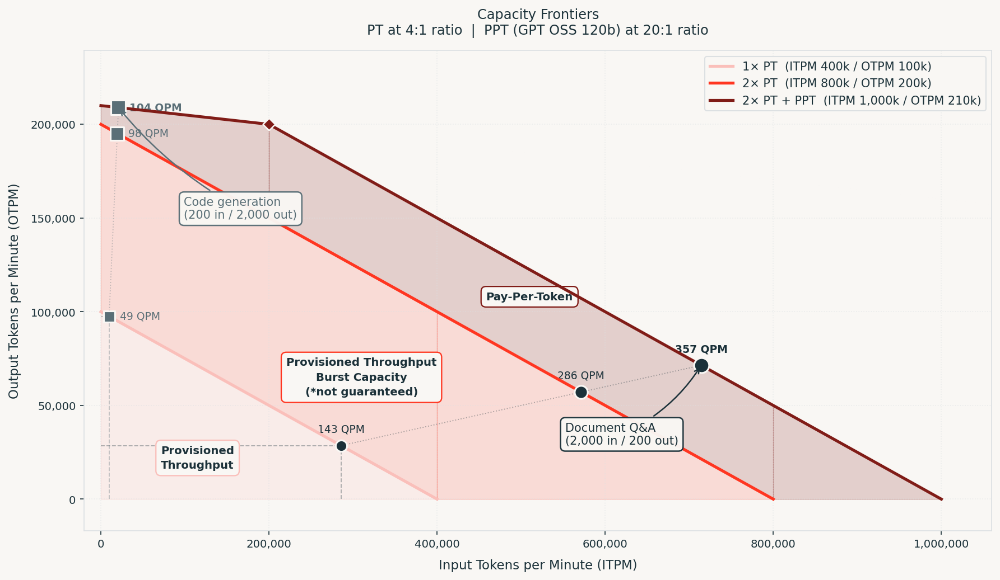

# LLM Capacity Planning

**TLDR: This blueprint helps size LLM capacity on Databricks.**

- Profile real requests to measure token usage and latency.
- Determine whether pay-per-token (PPT) meets expected demand.
- Size provisioned throughput (PT) when dedicated capacity is needed.
- Use a Unity Gateway Model Service to route to PT, with PPT as fallback.

This blueprint helps you size and deploy a production LLM serving architecture on Databricks using two levers: **Provisioned Throughput (PT)** and **Pay-Per-Token (PPT)**.

Your demand is defined by three numbers from your workload:

- **Avg input tokens per request**
- **Avg output tokens per request**
- **QPM** (queries per minute)

From these, derive your throughput demand: `ITPM = input_tokens × QPM` and `OTPM = output_tokens × QPM`. These are what you size against.

---

<p align="center">
  
  <br/>
  <em>PT provisioned capacity, burst, and PPT fallback plotted as capacity frontiers. Output tokens are 4–20× more compute-intensive than input tokens, making output throughput the binding constraint for most workloads. A RAG request (2,000 input / 200 output) and a code generation request (200 input / 2,000 output) carry the same total tokens but land in completely different positions on these frontiers.</em>
</p>

---

## The Two Levers

### Pay-Per-Token (PPT)
Shared infrastructure — pay only for tokens consumed, no capacity to manage. Hard ceilings on both input and output throughput.

| | GPT OSS 120B |
|---|---|
| Input cost | $0.15 / 1M tokens |
| Output cost | $0.60 / 1M tokens |
| Max ITPM | 200,000 tokens/min |
| Max OTPM | 10,000 tokens/min |
| Max QPM | ~200 QPS (workspace limit) |

The 20:1 ITPM-to-OTPM ratio reflects the compute asymmetry between prefill and decode: input tokens are processed in a single parallel forward pass (prefill), while each output token is generated one at a time, attending over the full context on every step (decode). The same GPU serves both, but decode is far more resource-intensive per token — which is why input and output throughput must be sized separately. **Output throughput is almost always the binding constraint** — a RAG workload at 200 input / 200 output tokens per request hits its OTPM ceiling at just 50 QPM. Size against OTPM first.

### Provisioned Throughput (PT)
Dedicated capacity measured in **model units**, billed hourly. Guarantees a throughput floor and includes burst scaling — Databricks can temporarily step up one model unit increment (e.g., 50 → 100 units) when regional capacity is available.

---

## Sizing Workflow

### Step 1 — Profile your workload (`profile_workload.ipynb`)

Fill in the **CUSTOMER CONFIGURATION** cell at the top of the notebook: set `PPT_MODEL`, replace `SYSTEM_PROMPT` with your real system prompt, and populate the sample lists that match your workload:

| Sample list | Populate if you have… |
|---|---|
| `RAG_SAMPLES` | A vector DB retrieval step that assembles context into the prompt |
| `CHAT_SAMPLES` | A conversational assistant with session history |
| `TRACE_SAMPLES` | An agent that makes multiple LLM calls per request (uses MLflow traces) |

Leave unused lists as `[]` — those workload cells skip automatically. Then **Run All** cells top to bottom.

Do not estimate token counts — real input/output distributions vary significantly by workload type, and the wrong profile will produce the wrong PT sizing.

### Step 2 — Check whether PPT is sufficient

**If you don't have production QPM data** (most customers sizing a new or early workload), reverse-calculate how much QPM PPT can actually serve for your request shape. The notebook does this automatically after profiling:

```
max_qpm_from_itpm = 200,000 / avg_input_tokens
max_qpm_from_otpm = 10,000  / avg_output_tokens
ppt_max_qpm       = min(max_qpm_from_itpm, max_qpm_from_otpm)
```

This gives you a concrete QPM ceiling to plan against. If you expect to exceed it at launch or in the near term, start with PT now rather than migrating later under pressure.

**If you have production QPM data** but aren't sure what to look for: pull P75–P90 QPM over a 1–2 week window from your observability stack (Datadog, Grafana, Databricks system tables). Use that as your QPM, then check: `ITPM = avg_input × QPM` and `OTPM = avg_output × QPM` against the PPT ceilings above. P75–P90 captures your routine load without over-indexing on rare spikes.

**Decision:**
- **QPM below `ppt_max_qpm`:** Stay on PPT. Done.
- **QPM at or above `ppt_max_qpm`:** PT is required — PPT physically cannot serve your load.

### Step 3 — Size your PT endpoint

Use the **[Databricks GenAI Pricing Calculator](https://www.databricks.com/product/pricing/genai-pricing-calculator)** with:
- Cloud provider + region
- Model
- **Avg input tokens** — from `profile_workload.ipynb`
- **Avg output tokens** — from `profile_workload.ipynb`
- **QPM floor** — use the `ppt_max_qpm` from Step 2 as your starting point, or your P75–P90 if you have production data. Apply a 2–3× safety factor if sizing a new workload and cannot tolerate a queue.

After deploying, load test with traffic that matches your real input/output distribution. Observe where 429s begin — that is your actual ceiling. Adjust model units and repeat if needed.

### Step 4 — Route requests with a Unity Gateway Model Service

Create a Unity Gateway Model Service with your provisioned-throughput endpoint as the primary destination and the equivalent pay-per-token model as its fallback. Applications call the model service, and Unity Gateway manages routing and fallback.

In the model service's routing configuration:

1. Add your PT endpoint as the primary destination.
2. Add the equivalent PPT model as a fallback destination.
3. Point your application at the model service.

PT covers your baseline demand, while PPT fallback provides additional capacity for traffic spikes:

```
┌──────────────────────────────────────────────────────┐
│  PPT fallback          ← spikes PT burst can't absorb │
├──────────────────────────────────────────────────────┤
│  PT burst (100 units)  ← moderate spikes above floor  │
├──────────────────────────────────────────────────────┤
│  PT provisioned (50 units) ← your QPM floor           │
└──────────────────────────────────────────────────────┘
```

Configure fallback in the model service rather than deploying a custom routing model. See [Unity Gateway routing and fallbacks](https://docs.databricks.com/aws/en/ai-gateway/configure-traffic-splitting) for configuration and fallback behavior. PPT remains subject to its own capacity limits; if fallback usage is consistently elevated, increase PT capacity.

---

## Contents

| File | Purpose |
|---|---|
| `profile_workload.ipynb` | Profile your workload on PPT: measure input/output tokens, TTFT, TPOT |
