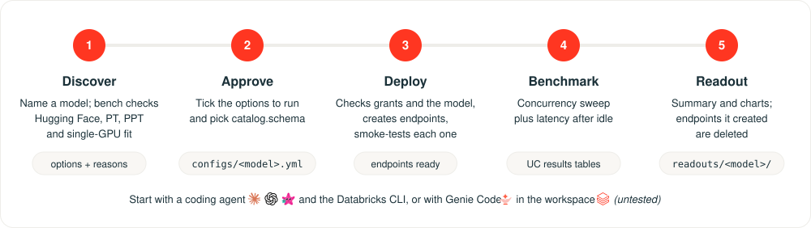
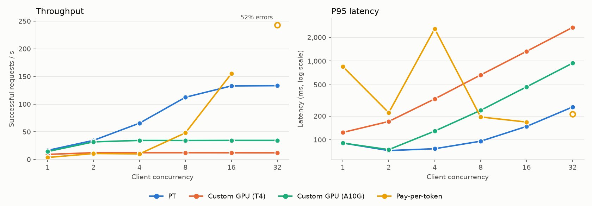

# Choosing a serving method for an open-source model

## Question

For a given Hugging Face model, which Databricks serving method meets my throughput and latency needs?

## Takeaway

**Choose the lowest-cost serving option that meets your required RPS and latency at expected concurrency.** Serving bench doesn't ship a fixed answer; it produces one for your model. It finds which options can serve the model, deploys the ones you pick, and measures them side by side. The options are provisioned throughput (PT), pay-per-token (PPT), and custom GPU serving with Express deployment on any single-GPU type your cloud offers.

Example for GTE-Large-EN-v1.5 with 256-token inputs ([full readout](readouts/gte-large-en-v1.5/README.md)):

Read it as: PT gives the most dedicated throughput; a single GPU plateaus early (T4 and A10G at C2), beyond which extra concurrency only adds queueing; pay-per-token has a wide, uneven tail and hit the workspace's rate limit above C16. Numbers depend on model, input size, workspace and region; run it for your own workload.

Not every option exists for every model. PT and PPT need a `system.ai` copy of the model; all-MiniLM-L6-v2, for example, has neither and is custom-GPU only. Custom GPU needs the model to fit on one GPU and to run on a serverless GPU AI environment; GTE v1.5's remote code, for example, fails on AI environment v6 (transformers 5.x) and runs on v5.

### Scope

- **Load test:** a closed-loop concurrency sweep. It measures achieved RPS at each level, not behavior at a target arrival rate.
- **Statistics:** P50 summarizes typical latency; P95/P99 are exploratory at this sample size.
- **Idle test:** client-observed latency after up to five minutes of inactivity; it can't separate a cold start from shared-pool load.
- **Chat:** latency is the full response, not time to first token. Custom chat runs vLLM on one GPU ([custom LLM serving](https://docs.databricks.com/aws/en/machine-learning/model-serving/serve-custom-llms), Public Preview), needs AI environment v6 or newer, and isn't available on GCP.
- **GPUs:** single-GPU types only. GPU fit is a memory estimate; the deploy step proves a model runs. Availability varies by region.
- **Cost:** not calculated. Compare results against your own pricing.

## How to run

**Prerequisites:** permission to create serving endpoints; `CREATE MODEL` and `CREATE TABLE` on a target schema; read access to `system.ai` and the shared PPT endpoint; serverless GPU (A10) for custom models and serverless CPU for the benchmark. No data needed: inputs are generated with the model's tokenizer, which needs Hugging Face access for gated models.

**With a coding agent:** start Claude Code (`claude`), Codex, Cursor or Genie Code CLI in this folder and say "benchmark \<model\>". [AGENTS.md](AGENTS.md) drives the workflow above. Genie Code in the workspace reads the same file (untested).

**By hand:** import this folder into a workspace, then:

1. Run [00_discover](00_discover.py) with the `hf_name` and `task` widgets to see which options can serve the model.
2. Copy [configs/example.yml](configs/example.yml) to `configs/<model>.yml` and paste in the endpoint blocks you want.
3. Run [01_deploy](01_deploy.py) on Serverless GPU with AI environment `model.ai_env`. If the model check fails, run [00_compat_check](00_compat_check.py) on each of `model.ai_env_candidates` and set `ai_env` to the newest that passes.
4. Run [02_benchmark](02_benchmark.py) on serverless CPU (about 45–60 minutes with the defaults).

Results land in `{catalog}.{schema}.serving_bench_requests` and `serving_bench_summary`, keyed by `run_id`. Build the readout with `python lib/make_readout.py --config configs/<model>.yml --run-id <run_id> --profile <profile>`.

**Cleanup:** `02_benchmark` deletes the PT and custom endpoints it created once results are saved. If a run fails first, delete them with `databricks serving-endpoints delete <name>`. Shared PPT endpoints are never deleted.

**Tests:** `uv run --no-project --with pytest --with pyyaml --with matplotlib python -m pytest -q tests`
