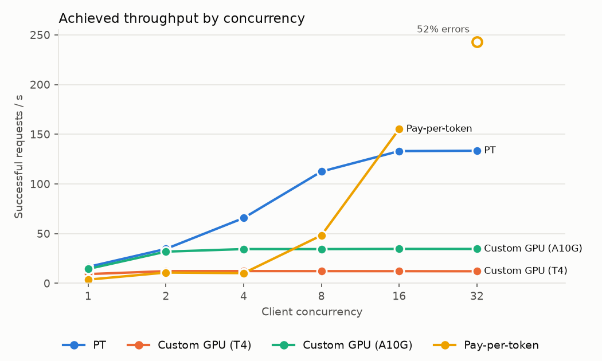

# Choosing a serving method for an open-source model

## Question

For a given Hugging Face model, which Databricks serving method meets my throughput and latency needs?

## Takeaway

**Choose the lowest-cost serving option that meets your required RPS and latency at expected concurrency.** Serving bench doesn't ship a fixed answer; it produces one for your model. It finds which options can serve the model, deploys the ones you pick, and measures them side by side. The options are provisioned throughput (PT), pay-per-token (PPT), and custom GPU serving with Express deployment on any single-GPU type your cloud offers.

Each run produces a readout in [readouts/](readouts/), one folder per model with a summary, charts, and per-level results. Example output for GTE-Large-EN-v1.5 (256-token inputs, [full readout](readouts/gte-large-en-v1.5/README.md)):

| Endpoint | Peak RPS | Saturation concurrency | P50 @ sat | P95 @ sat | Errors | Warm latency | Latency after 5 min idle | Std after 5 min idle | Notes |
| --- | ---: | ---: | ---: | ---: | ---: | ---: | ---: | ---: | --- |
| PT | 133.4 | 16 | 111 ms | 148 ms | 0 | 164 ms | 147 ms | 15 ms | |
| Custom GPU (T4) | 12.3 | 2 | 162 ms | 171 ms | 0 | 181 ms | 245 ms | 13 ms | |
| Custom GPU (A10G) | 34.6 | 2 | 60 ms | 75 ms | 0 | 155 ms | 195 ms | 34 ms | |
| Pay-per-token | 155.2 | 16 | 68 ms | 168 ms | 332 | 155 ms | 256 ms | 193 ms | C32 excluded: 52% errors (rate-limited, HTTP 429) |



Read it as: PT gives the most dedicated throughput; a single GPU plateaus early (T4 at C2, A10G at C2–4), beyond which extra concurrency only adds queueing; pay-per-token keeps a low P50 but has a wide tail and hit the workspace's QPS rate limit above C16. Numbers depend on model, input size, workspace and region; run it for your own workload.

Not every option exists for every model. PT and PPT need a `system.ai` copy of the model; all-MiniLM-L6-v2, for example, has neither and is custom-GPU only. Custom GPU needs the model to fit on one GPU and to run on a serverless GPU AI environment; GTE v1.5's remote code, for example, fails on AI environment v6 (transformers 5.x) and runs on v5.

### Scope

- **Load test:** a closed-loop concurrency sweep (at least 100 requests per level, scaling to 20 per concurrent client). It measures achieved RPS at each concurrency level, not behavior at a target arrival rate. Beyond saturation, extra concurrency mainly adds queueing latency.
- **Statistics:** P50 summarizes typical latency; P95/P99 are exploratory at this sample size.
- **Idle test:** three probes per duration, up to five minutes. It measures client-observed latency after inactivity and can't separate a cold start from shared-pool load or connection setup.
- **Chat:** latency is the full generated response, not time to first token. Custom chat runs a built-in HF causal LM in fp16 on one GPU and needs a chat template; remote-code chat models aren't supported.
- **GPUs:** discovery reads the custom model serving GPU list from the Databricks docs for your workspace's cloud (e.g. T4, A10G and L40 on AWS; T4 and A100 on Azure; L4 on GCP). Multi-GPU types are listed but excluded: the serving adapters run the model on one GPU. GPU fit is a memory estimate; only the deploy step proves a model runs. Availability varies by region.
- **Cost:** not calculated. Compare results against your own pricing and utilization.

## How to run

### Prerequisites

- **Compute:**
  - Serverless GPU (A10) to log custom models.
  - Serverless CPU to run the benchmark.
  - Not needed for PT/PPT-only runs: the GPU step.
- **Permissions:**
  - Create serving endpoints.
  - `CREATE MODEL` and `CREATE TABLE` on the target schema.
  - Read `system.ai`.
  - Query permission on the shared PPT endpoint.
- **Data:** none. The benchmark generates inputs with the model's tokenizer. Gated Hugging Face models need `HF_TOKEN` for discovery.

### With a coding agent

[SKILL.md](SKILL.md) walks an agent through the whole workflow. To use it with Claude Code, link it to `.claude/skills/serving-bench/SKILL.md` and ask which serving method suits a model. The agent then:

1. Asks for the model, task (`embedding` or `chat`), workspace profile and target `catalog.schema`.
2. Runs discovery and shows every option, including the ones that won't work and why.
3. Writes `configs/<model>.yml` from the options and settings you approve.
4. Deploys and benchmarks as Databricks jobs.
5. Reports the readout and offers cleanup.

If the model fails on the latest AI environment, the agent asks before testing the two previous environments in parallel. It then redeploys on the newest one that passes.

### By hand

1. **Import** this folder into a workspace folder.
2. **Discover.** Run [00_discover](00_discover.py) with the `hf_name` and `task` widgets, or from a laptop with `databricks-sdk` installed:

   ```bash
   python discover.py --model Alibaba-NLP/gte-large-en-v1.5 --task embedding --profile <profile>
   ```

   The output lists PT (smallest capacity increment), PPT, and memory fit on each GPU type your cloud offers, each with a reason. It also includes ready-to-paste `model` and `endpoint` blocks. Discovery is read-only.
3. **Configure.** Copy [configs/example.yml](configs/example.yml) to `configs/<model>.yml` (e.g. `configs/gte-large-en-v1.5.yml`; gitignored) and pass its path as each notebook's `config_path` widget. Paste in the `model` block and the endpoints you want, then set `unity_catalog` and the load/idle test settings.
4. **Deploy.** Run [01_deploy](01_deploy.py) on Serverless GPU with the AI environment in `model.ai_env`; any compute works for PT/PPT-only configs.
   - The notebook first loads the model and runs one inference. If that fails, it stops before creating anything. Run [00_compat_check](00_compat_check.py) on each environment in `model.ai_env_candidates`, then set `ai_env` to the newest one that passes.
   - Otherwise it registers the model with Express `env_pack` and creates the selected PT and custom endpoints. It then waits until every endpoint is `READY` and smoke-tests each one. Dedicated endpoints commonly take 15–30 minutes.
5. **Benchmark.** Run [02_benchmark](02_benchmark.py) on serverless CPU. The default settings take about 45–60 minutes, including roughly 25 minutes of idle tests.

### Expected output

- `02_benchmark` shows throughput and latency curves, idle-latency charts, and a readout table. The table lists peak RPS, saturation concurrency, P50/P95 at saturation, errors, warm latency, and the mean and std of latency after the longest idle.
- Every request is appended to `{catalog}.{schema}.serving_bench_requests`, and per-level stats to `serving_bench_summary`, both keyed by `run_id`.
- When `02_benchmark` runs as a job, it exits with the readout as JSON, which you can fetch with `databricks jobs get-run-output`. To build the full readout (summary, charts, per-level table) from the saved data, run `python make_readout.py --config configs/<model>.yml --run-id <run_id> --profile <profile>`. It writes [readouts/](readouts/)`<model>/`, one folder per model, and needs `matplotlib` and `databricks-sdk`. No endpoints are needed, so you can regenerate it any time.

### Cleanup

Dedicated endpoints incur charges while running and can't be stopped, only deleted. By default, `02_benchmark` deletes the PT and custom endpoints the framework created (tagged `created_by=serving-bench`) once results are saved; set `cleanup.delete_endpoints_after_benchmark: false` to keep them. If a run fails before that, delete them with `databricks serving-endpoints delete <name>`. Shared PPT endpoints are never deleted. Registered model versions stay in Unity Catalog; optionally remove them and the results tables.

### Tests

```bash
uv run --no-project --with pytest --with pyyaml --with matplotlib python -m pytest -q tests
```
