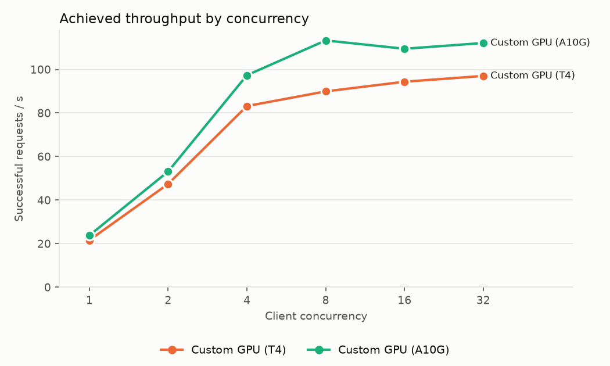
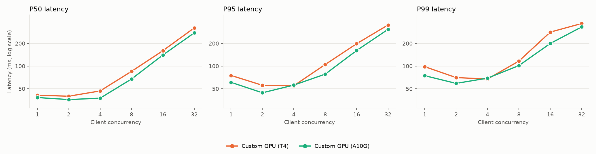
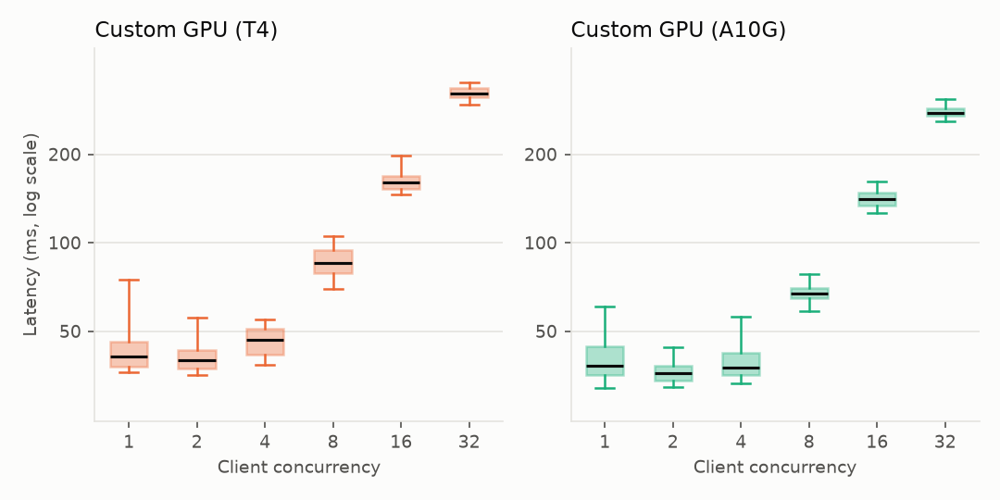
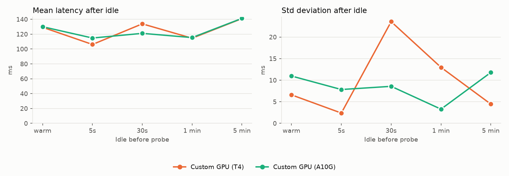

# sentence-transformers/all-MiniLM-L6-v2 (embedding)

Run `run_45a9fbecf663` on 2026-10-21 in https://e2-demo-field-eng.cloud.databricks.com.

| Endpoint | Peak RPS | Saturation concurrency | P50 @ sat | P95 @ sat | Errors | Warm latency | Latency after longest idle | Std after longest idle | Notes |
| --- | ---: | ---: | ---: | ---: | ---: | ---: | ---: | ---: | --- |
| Custom GPU (T4) | 97.0 | 8 | 85 ms | 105 ms | 0 | 129 ms | 141 ms (300s, 0 failed) | 4 ms |  |
| Custom GPU (A10G) | 113.3 | 8 | 67 ms | 78 ms | 0 | 130 ms | 141 ms (300s, 0 failed) | 12 ms |  |

## Settings

- Input: 256 tokens, same text for every request.
- Concurrency levels: 1, 2, 4, 8, 16, 32; requests per level: max(100, 20 × concurrency).
- Idle test: 5s, 30s, 60s, 300s × 3 reps; one probe per rep after each idle duration.
- Saturation concurrency: the lowest level reaching 90% of peak RPS. Levels with more than 1% failed
  requests are excluded from peak and saturation (see Notes); their RPS counts only requests that got through.
- Custom models logged on AI env v5.

## Endpoints

- Custom GPU (T4): `sb-all-minilm-l6-v2-gpu-small` (custom, GPU_SMALL, scale-to-zero off)
- Custom GPU (A10G): `sb-all-minilm-l6-v2-gpu-medium` (custom, GPU_MEDIUM, scale-to-zero off)

Raw data: `serving_bench_requests` and `serving_bench_summary`, filtered on `run_id = 'run_45a9fbecf663'`.

## Charts

### Throughput

Successful requests per second at each client concurrency. A flat line means the endpoint is saturated:
more clients only queue. Hollow markers are levels with more than 1% errors; their RPS counts only the
requests that got through.

### Latency percentiles

P50/P95/P99 of successful requests at each level (log scale). Past saturation, latency grows roughly
in proportion to concurrency.

### Latency distribution

Every successful load request: box = P25–P75, line = median, whiskers = P5–P95 (log scale).

### Latency after idle

One probe per rep after each idle period, from a warm endpoint. Client-observed: this can't separate a
cold start from shared-pool load or connection setup.

## Per-level results

| Endpoint | Concurrency | Requests | RPS | P50 ms | P95 ms | P99 ms | Errors | Duration s | Note |
| --- | ---: | ---: | ---: | ---: | ---: | ---: | ---: | ---: | --- |
| Custom GPU (T4) | 1 | 100 | 21.6 | 41 | 75 | 98 | 0 | 4.6 |  |
| Custom GPU (T4) | 2 | 100 | 47.4 | 40 | 56 | 70 | 0 | 2.1 |  |
| Custom GPU (T4) | 4 | 100 | 83.2 | 47 | 55 | 67 | 0 | 1.2 |  |
| Custom GPU (T4) | 8 | 160 | 89.9 | 85 | 105 | 117 | 0 | 1.8 |  |
| Custom GPU (T4) | 16 | 320 | 94.4 | 161 | 199 | 284 | 0 | 3.4 |  |
| Custom GPU (T4) | 32 | 640 | 97.0 | 323 | 352 | 369 | 0 | 6.6 |  |
| Custom GPU (A10G) | 1 | 100 | 23.8 | 38 | 61 | 75 | 0 | 4.2 |  |
| Custom GPU (A10G) | 2 | 100 | 53.1 | 36 | 44 | 59 | 0 | 1.9 |  |
| Custom GPU (A10G) | 4 | 100 | 97.3 | 37 | 56 | 69 | 0 | 1.0 |  |
| Custom GPU (A10G) | 8 | 160 | 113.3 | 67 | 78 | 102 | 0 | 1.4 |  |
| Custom GPU (A10G) | 16 | 320 | 109.5 | 141 | 161 | 200 | 0 | 2.9 |  |
| Custom GPU (A10G) | 32 | 640 | 112.1 | 277 | 308 | 332 | 0 | 5.7 |  |
