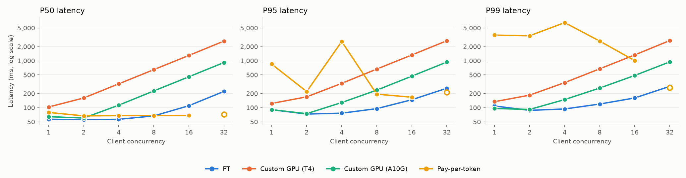
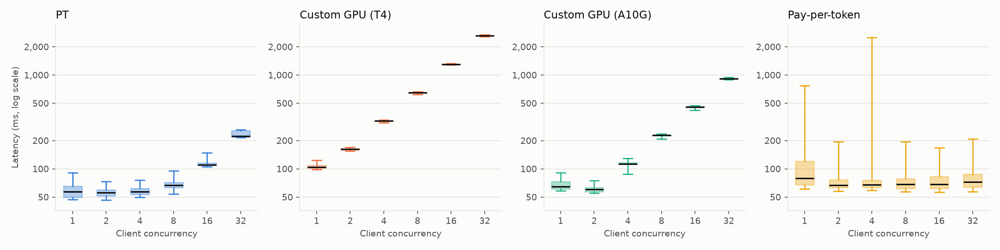
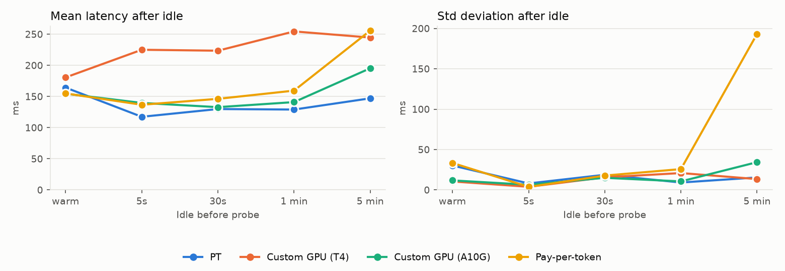

# Alibaba-NLP/gte-large-en-v1.5 (embedding)

Run `run_d6fa3b14e837` on 2026-10-21 in https://e2-demo-field-eng.cloud.databricks.com.

| Endpoint | Peak RPS | Saturation concurrency | P50 @ sat | P95 @ sat | Errors | Warm latency | Latency after longest idle | Std after longest idle | Notes |
| --- | ---: | ---: | ---: | ---: | ---: | ---: | ---: | ---: | --- |
| PT | 133.4 | 16 | 111 ms | 148 ms | 0 | 164 ms | 147 ms (300s, 0 failed) | 15 ms |  |
| Custom GPU (T4) | 12.3 | 2 | 162 ms | 171 ms | 0 | 181 ms | 245 ms (300s, 0 failed) | 13 ms |  |
| Custom GPU (A10G) | 34.6 | 2 | 60 ms | 75 ms | 0 | 155 ms | 195 ms (300s, 0 failed) | 34 ms |  |
| Pay-per-token | 155.2 | 16 | 68 ms | 168 ms | 332 | 155 ms | 256 ms (300s, 0 failed) | 193 ms | C32 excluded: 52% errors (rate-limited, HTTP 429) |

## Settings

- Input: 256 tokens, same text for every request.
- Concurrency levels: 1, 2, 4, 8, 16, 32; requests per level: max(100, 20 × concurrency).
- Idle test: 5s, 30s, 60s, 300s × 3 reps; one probe per rep after each idle duration.
- Saturation concurrency: the lowest level reaching 90% of peak RPS. Levels with more than 1% failed
  requests are excluded from peak and saturation (see Notes); their RPS counts only requests that got through.
- Custom models logged on AI env v5.

## Endpoints

- PT: `sb-gte-large-en-v1-5-pt` (pt, system.ai.gte_large_en_v1_5 v2, 19000–19000 tokens/s)
- Custom GPU (T4): `sb-gte-large-en-v1-5-gpu-small` (custom, GPU_SMALL, scale-to-zero off)
- Custom GPU (A10G): `sb-gte-large-en-v1-5-gpu-medium` (custom, GPU_MEDIUM, scale-to-zero off)
- Pay-per-token: `databricks-gte-large-en` (ppt, shared)

Raw data: `serving_bench_requests` and `serving_bench_summary`, filtered on `run_id = 'run_d6fa3b14e837'`.

## Charts

### Throughput

Successful requests per second at each client concurrency. A flat line means the endpoint is saturated:
more clients only queue. Hollow markers are levels with more than 1% errors; their RPS counts only the
requests that got through.

### Latency percentiles

P50/P95/P99 of successful requests at each level (log scale). Past saturation, latency grows roughly
in proportion to concurrency.

### Latency distribution

Every successful load request: box = P25–P75, line = median, whiskers = P5–P95 (log scale).

### Latency after idle

One probe per rep after each idle period, from a warm endpoint. Client-observed: this can't separate a
cold start from shared-pool load or connection setup.

## Per-level results

| Endpoint | Concurrency | Requests | RPS | P50 ms | P95 ms | P99 ms | Errors | Duration s | Note |
| --- | ---: | ---: | ---: | ---: | ---: | ---: | ---: | ---: | --- |
| PT | 1 | 100 | 16.5 | 57 | 91 | 109 | 0 | 6.0 |  |
| PT | 2 | 100 | 34.6 | 56 | 73 | 88 | 0 | 2.9 |  |
| PT | 4 | 100 | 65.7 | 57 | 77 | 94 | 0 | 1.5 |  |
| PT | 8 | 160 | 112.5 | 67 | 96 | 120 | 0 | 1.4 |  |
| PT | 16 | 320 | 133.0 | 111 | 148 | 162 | 0 | 2.4 |  |
| PT | 32 | 640 | 133.4 | 223 | 261 | 286 | 0 | 4.8 |  |
| Custom GPU (T4) | 1 | 100 | 9.3 | 104 | 124 | 135 | 0 | 10.8 |  |
| Custom GPU (T4) | 2 | 100 | 12.3 | 162 | 171 | 186 | 0 | 8.2 |  |
| Custom GPU (T4) | 4 | 100 | 12.3 | 324 | 331 | 343 | 0 | 8.1 |  |
| Custom GPU (T4) | 8 | 160 | 12.3 | 649 | 667 | 675 | 0 | 13.1 |  |
| Custom GPU (T4) | 16 | 320 | 12.2 | 1302 | 1332 | 1335 | 0 | 26.2 |  |
| Custom GPU (T4) | 32 | 640 | 12.1 | 2630 | 2678 | 2703 | 0 | 52.7 |  |
| Custom GPU (A10G) | 1 | 100 | 14.4 | 65 | 91 | 97 | 0 | 6.9 |  |
| Custom GPU (A10G) | 2 | 100 | 31.9 | 60 | 75 | 92 | 0 | 3.1 |  |
| Custom GPU (A10G) | 4 | 100 | 34.5 | 114 | 129 | 149 | 0 | 2.9 |  |
| Custom GPU (A10G) | 8 | 160 | 34.4 | 228 | 237 | 263 | 0 | 4.6 |  |
| Custom GPU (A10G) | 16 | 320 | 34.6 | 457 | 471 | 487 | 0 | 9.2 |  |
| Custom GPU (A10G) | 32 | 640 | 34.6 | 919 | 942 | 950 | 0 | 18.5 |  |
| Pay-per-token | 1 | 100 | 3.7 | 80 | 853 | 3532 | 0 | 27.0 |  |
| Pay-per-token | 2 | 100 | 10.8 | 67 | 221 | 3411 | 0 | 9.2 |  |
| Pay-per-token | 4 | 100 | 10.2 | 68 | 2577 | 6510 | 0 | 9.8 |  |
| Pay-per-token | 8 | 160 | 48.2 | 68 | 195 | 2631 | 0 | 3.3 |  |
| Pay-per-token | 16 | 320 | 155.2 | 68 | 168 | 1008 | 0 | 2.1 |  |
| Pay-per-token | 32 | 640 | 242.9 | 72 | 212 | 266 | 332 | 1.3 | excluded: 52% errors (429) |
