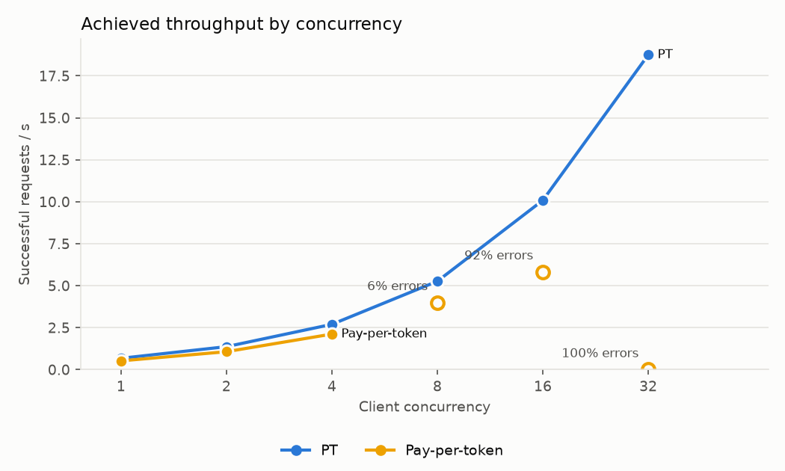
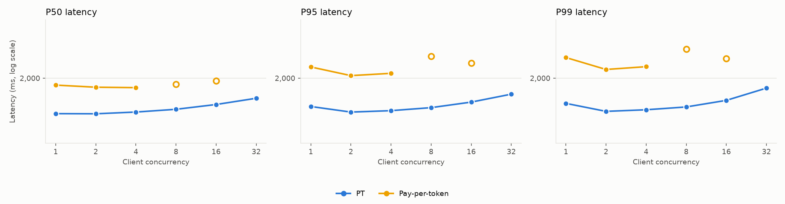
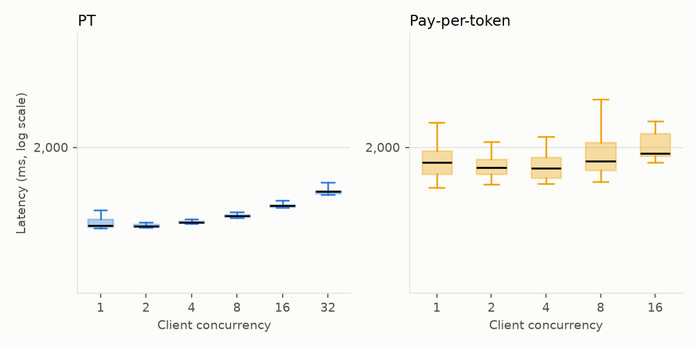
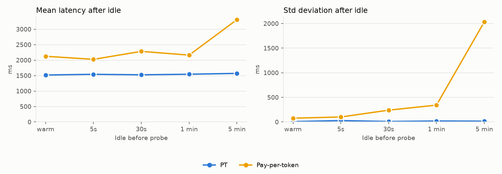

# unsloth/Llama-3.3-70B-Instruct (chat)

Run `run_ea719e4152c4` on 2026-10-22 in https://e2-demo-field-eng.cloud.databricks.com.

| Endpoint | Peak RPS | Saturation concurrency | P50 @ sat | P95 @ sat | Errors | Warm latency | Latency after longest idle | Std after longest idle | Notes |
| --- | ---: | ---: | ---: | ---: | ---: | ---: | ---: | ---: | --- |
| PT | 18.7 | 32 | 1,673 ms | 1,735 ms | 0 | 1,519 ms | 1,571 ms (300s, 0 failed) | 16 ms |  |
| Pay-per-token | 2.1 | 4 | 1,839 ms | 2,088 ms | 945 | 2,124 ms | 3,309 ms (300s, 0 failed) | 2,034 ms | C8 excluded: 6% errors (rate-limited, HTTP 429); C16 excluded: 92% errors (rate-limited, HTTP 429); C32 excluded: 100% errors (rate-limited, HTTP 429) |

## Settings

- Input: 256 tokens, same text for every request.
- Concurrency levels: 1, 2, 4, 8, 16, 32; requests per level: max(100, 20 × concurrency).
- Idle test: 5s, 30s, 60s, 300s × 3 reps; one probe per rep after each idle duration.
- Saturation concurrency: the lowest level reaching 90% of peak RPS. Levels with more than 1% failed
  requests are excluded from peak and saturation (see Notes); their RPS counts only requests that got through.
- Custom models logged on AI env v6.

## Endpoints

- PT: `sb-llama-3-3-70b-instruct-pt` (pt, system.ai.llama_v3_3_70b_instruct v1, 9500–9500 tokens/s)
- Pay-per-token: `databricks-meta-llama-3-3-70b-instruct` (ppt, shared)

Raw data: `serving_bench_requests` and `serving_bench_summary`, filtered on `run_id = 'run_ea719e4152c4'`.

## Charts

### Throughput

Successful requests per second at each client concurrency. A flat line means the endpoint is saturated:
more clients only queue. Hollow markers are levels with more than 1% errors; their RPS counts only the
requests that got through.

### Latency percentiles

P50/P95/P99 of successful requests at each level (log scale). Past saturation, latency grows roughly
in proportion to concurrency.

### Latency distribution

Every successful load request: box = P25–P75, line = median, whiskers = P5–P95 (log scale).

### Latency after idle

One probe per rep after each idle period, from a warm endpoint. Client-observed: this can't separate a
cold start from shared-pool load or connection setup.

## Per-level results

| Endpoint | Concurrency | Requests | RPS | P50 ms | P95 ms | P99 ms | Errors | Duration s | Note |
| --- | ---: | ---: | ---: | ---: | ---: | ---: | ---: | ---: | --- |
| PT | 1 | 100 | 0.7 | 1459 | 1555 | 1598 | 0 | 147.7 |  |
| PT | 2 | 100 | 1.4 | 1457 | 1479 | 1489 | 0 | 73.0 |  |
| PT | 4 | 100 | 2.7 | 1480 | 1498 | 1510 | 0 | 37.1 |  |
| PT | 8 | 160 | 5.3 | 1516 | 1539 | 1549 | 0 | 30.4 |  |
| PT | 16 | 320 | 10.1 | 1582 | 1617 | 1642 | 0 | 31.7 |  |
| PT | 32 | 640 | 18.7 | 1673 | 1735 | 1831 | 0 | 34.1 |  |
| Pay-per-token | 1 | 100 | 0.5 | 1881 | 2210 | 2403 | 0 | 191.3 |  |
| Pay-per-token | 2 | 100 | 1.1 | 1846 | 2046 | 2162 | 0 | 93.5 |  |
| Pay-per-token | 4 | 100 | 2.1 | 1839 | 2088 | 2216 | 0 | 47.2 |  |
| Pay-per-token | 8 | 160 | 4.0 | 1893 | 2432 | 2587 | 10 | 37.5 | excluded: 6% errors (429) |
| Pay-per-token | 16 | 320 | 5.8 | 1953 | 2286 | 2383 | 295 | 4.3 | excluded: 92% errors (429) |
| Pay-per-token | 32 | 640 | 0.0 | — | — | — | 640 | 0.6 | excluded: 100% errors (429) |
