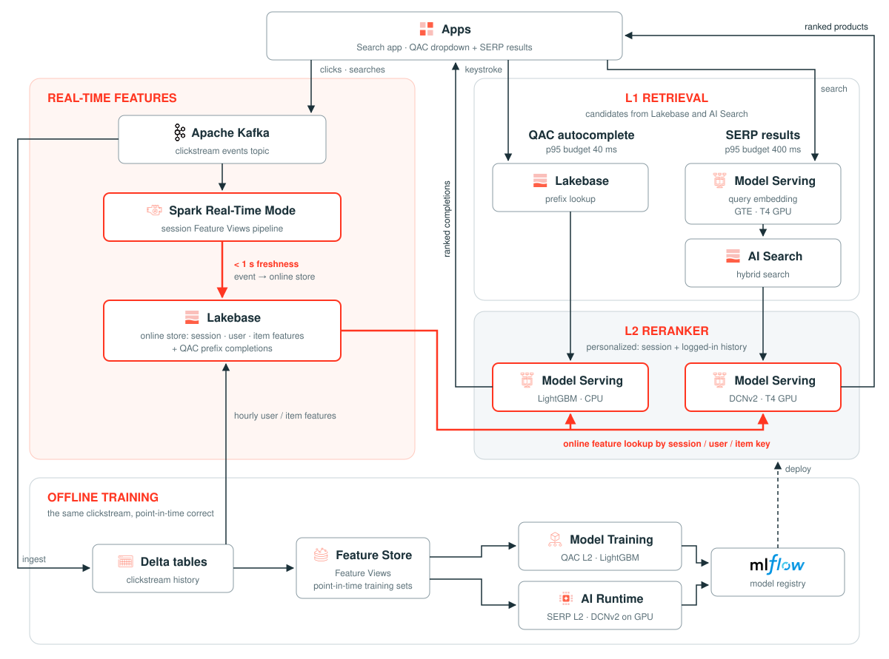

# Real-time search on Databricks: personalized QAC and SERP



<sub>**Anatomy of a search bar.** **Query auto-completion (QAC)** suggests whole queries in a dropdown on every
keystroke. The **search engine results page (SERP)** ranks products once a query is submitted. Both need low-latency
serving: QAC has about 40 ms per keystroke and SERP a few hundred. Both also rank much better when they use what the
shopper has done this session and in past visits.</sub>

**Question:** What does a real-time search solution on Databricks look like?

**Takeaway:** You can build it end to end on Databricks, with each real-time piece on a managed service:

- **Feature Views** keep clickstream features fresh (event → online store p50 58 ms / p95 442 ms, from Kafka through
  Spark Real-Time Mode). The same feature definitions build point-in-time training sets offline and are looked up
  online at serving time, so training and serving can't drift.
- **AI Runtime** trains the GPU model (DCNv2 on a serverless A10). **Express** deployment has a GPU endpoint ready in
  about 5–7 minutes, with no image build.
- **Lakebase** serves online at very low latency: the QAC prefix lookup is p95 3.7 ms, and the session, user and item
  features behind both rerankers live there too.
- **AI Search** combines lexical and semantic retrieval (hybrid recall@200 0.876).
- **Latency is in line with QAC and SERP expectations:**
  - QAC: L1 + L2 fits the 40 ms server budget, and keystroke → on screen is ~120 ms.
  - SERP: an estimated ~360–370 ms in the app against a 400 ms budget. The in-app measurement is still pending.

Both surfaces retrieve, then rerank. L1 retrieves candidates: a Lakebase prefix lookup for QAC, AI Search hybrid for
SERP. L2 reranks them with features from the session and the logged-in user's history. When L2 is slow, the app falls
back to the L1 order. The data is Amazon ESCI plus simulated shopping sessions with a planted intent.

## Architecture



<sub>Generated by `docs/make_architecture.py`; to change it, edit the script and rerun it with
`uv run --no-project --with fonttools --with brotli python docs/make_architecture.py`.</sub>

## Results

| | Target | Measured |
|---|---|---|
| Feature freshness (event → online store) | < 1 s | p50 58 ms / p95 442 ms (18 probes); a Delta-table source took p50 158 s |
| QAC server, L1 + L2 | p95 40 ms | L1 p95 3.7 ms + L2 p95 ~35 ms; ~1 in 20 keystrokes falls back to L1 by design |
| QAC keystroke → on screen | p95 ≤ 120 ms | ~120 ms typical (20 ms debounce); not yet measured at p95 |
| SERP, embed → L1 → L2 | p95 400 ms | p95 502 ms from a laptop (WAN on each of 3 calls); ~360–370 ms estimated in the app |
| QAC relevance, L1 → L2 | | MRR@5 0.539 → 0.598 (+0.059); +0.101 on a session's 2nd+ search |
| SERP relevance, L1 → L2 | | NDCG@10 0.224 → 0.289 (+0.065) |

**Caveats**
- The sessions are simulated, and their intent never drifts within a session.
- QAC L2 is slightly worse than L1 when a session has no intent (MRR@5 −0.015).
- Most of the SERP lift isn't personalization: first searches and no-intent sessions gain about as much, likely from
  item popularity. The simulator inflates popularity, because only judged products are ever clicked.
- Logged-in users show a larger QAC lift than guests (+0.068 vs +0.045), but that comparison is confounded, so it
  doesn't isolate what user history adds.

Build status and the full measurements are in [PLAN.md](PLAN.md) and each track's plan. Deferred scope is in
[PARKING_LOT.md](PARKING_LOT.md).

## Repo layout and team ownership

The folders follow who owns what in production. Each one except `shared/` is its own Declarative Automation Bundle,
and the bundles only meet through the contracts in `shared/`.

```
shared/   contracts + platform helpers, synced into every bundle
  configs/              example.yml (committed), <target>.yml (gitignored, e.g. dev.yml)
  src/rts_shared/       config, events, features, scenarios, retrieval, kafka, lakebase
data/     bundle rts-data (data engineering): catalog, clickstream, Kafka Stream, Feature Views, demo scenarios
  resources/            catalog_job, clickstream_job, demo_job, teardown_job
ml/       bundle rts-ml (search relevance): L1 retrieval, L2 rankers, evaluation, endpoints
  resources/            retrieval_job, qac_l2_job, serp_l2_job
app/      bundle rts-app (frontend): FastAPI + React app rts-search
  resources/            rts_app, grants_job
```

| Contract | Owner | Consumers | Enforced by |
|---|---|---|---|
| Event schema and topic (`rts_shared.events`, `kafka.topic`) | data | app (produces), ml (trains) | `session_events` DDL and the Kafka payload schema are both generated from `EVENT_FIELDS` |
| Feature catalog (`rts_shared.features`: names and lookup keys) | data | ml | `data/tests/test_feature_specs.py` asserts the feature specs match it exactly |
| Demo scenarios (`rts_shared.scenarios`) | data | app | `SCENARIO_COLUMNS` and `replay`, tested |
| Retrieval outputs (`rts_shared.retrieval`: prefix table, index columns) | ml | app | `QAC_PREFIX_COLUMNS`, `SERP_INDEX_COLUMNS`, tested |
| L2 endpoint inputs | ml | app | `QAC_L2_REQUEST_COLUMNS`, `qac_l2_records`, `serp_l2_records`, tested |

Bundles refer to each other's objects by name through the shared config, never through `${resources...}`, so each
can deploy on its own (and later under its own service principal).

## How to run

1. Copy `shared/configs/example.yml` to `shared/configs/dev.yml` and fill it in. Notebooks run interactively read
   `dev.yml`; jobs read `shared/configs/<bundle target>.yml`.
2. Run the tests from this folder: `uv run --no-project --with pytest --with pyyaml python -m pytest -q`.
3. Deploy and run the data bundle:
   ```bash
   cd data
   databricks bundle deploy -t dev -p <profile>
   databricks bundle run catalog_job -t dev -p <profile>       # preflight, then ESCI + ai_classify
   databricks bundle run clickstream_job -t dev -p <profile>   # sim -> Kafka Stream -> Feature Views + checks
   databricks bundle run demo_job -t dev -p <profile>          # demo scenarios the app replays
   ```
   `clickstream_job` skips the simulator when `session_events` exists. To rebuild the data, run `teardown_job` with
   `--params confirm=yes` first, then `clickstream_job` with `--params rebuild_data=true`.
4. Deploy and run the ML bundle: L1 retrieval (prefix table, AI Search index, query-embedding endpoint), then each L2
   ranker and its endpoint:
   ```bash
   cd ml
   databricks bundle deploy -t dev -p <profile>
   databricks bundle run retrieval_job -t dev -p <profile>
   databricks bundle run qac_l2_job -t dev -p <profile>
   databricks bundle run serp_l2_job -t dev -p <profile>
   ```

### Run the app

```bash
cd app
databricks bundle deploy -t dev -p <profile>
databricks bundle run grants_job -t dev -p <profile>   # once: Lakebase SELECT for the app's service principal
databricks apps start rts-search -p <profile>
```

After the first deploy, also grant the app's service principal access to the Kafka service credential
(`kafka.service_credential` in the config), so the app can replay scenarios to Kafka:
`GRANT ACCESS ON SERVICE CREDENTIAL <credential> TO <app service principal>`. The session pipeline must be running for
Play to work. Redeploy the app bundle whenever an endpoint is recreated: deleting an endpoint drops the app's
`CAN_QUERY` on it.

Every notebook ends with checks that assert, so a green run means its claim held.

## Cleanup

- `databricks bundle run teardown_job -t dev -p <profile> --params confirm=yes` deletes the Feature Views and the
  Kafka Stream (with `confirm=no` it only lists them). The session streaming pipeline goes with them.
- Delete the serving endpoints (`rts-query-embedding`, `rts-qac-l2`, `rts-serp-l2`) and the AI Search endpoint when
  you're not using them: they bill while they exist.
- `databricks bundle destroy -t dev -p <profile>` in each bundle folder removes the jobs, the app and uploaded files.
- Tables in `<catalog>.<schema>`, the online store (Lakebase), the UC Kafka connection and the topic are kept.
  Drop them by hand if you're done with them.
