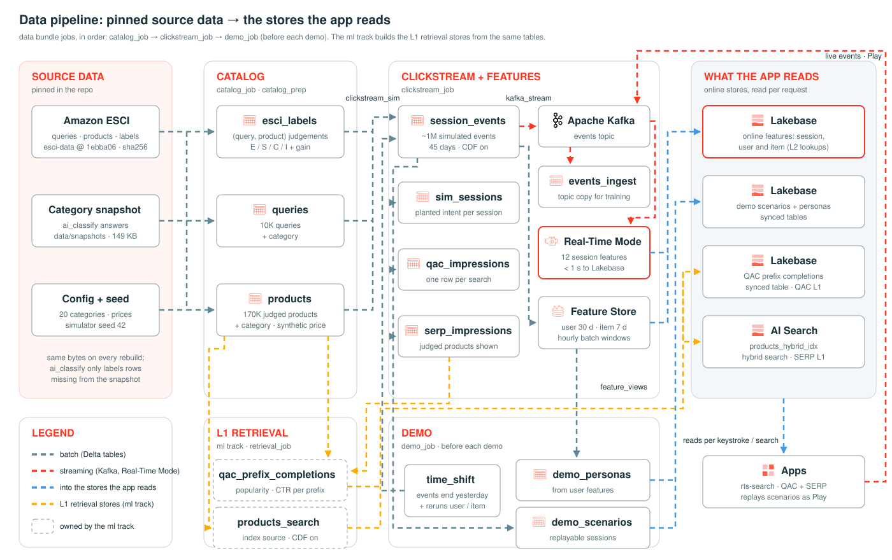

# Data pipeline (`data/`, bundle `rts-data`)

How the pinned source data becomes the tables and stores the app reads. For the system as a whole (L1 retrieval, L2
rerankers, serving), see the [top-level README](../README.md).

Generated by `docs/make_data_pipeline.py`; to change it, edit the script and rerun it from `real-time-search/` with
`uv run --no-project --with fonttools --with brotli python docs/make_data_pipeline.py`.

## Source data: pinned, so every rebuild starts from the same inputs

| Input | Where it comes from | How it's pinned |
|---|---|---|
| [Amazon ESCI](https://github.com/amazon-science/esci-data) (Apache-2.0): queries, products, E/S/C/I labels | Downloaded into the config's volume by `catalog_prep` | Commit `1ebba06` plus each file's sha256 and size from its Git LFS pointer (`rts_data.sources`); a mismatch stops the run |
| Categories (`ai_classify` over the config's 20 categories) | An LLM, so labels can differ between runs and as the model changes | Its answers are committed in [`snapshots/`](snapshots) (149 KB); `catalog_prep` calls `ai_classify` only for rows missing from them |
| Synthetic prices and sessions | `rts_data.datagen`, from the config | Seeded (`data.sim.seed`); the simulator sorts its inputs, so Spark's row order can't change the sessions |

After `catalog_prep` classifies new rows (for example a full ~97K-query run with `data.max_queries: null`), export them
and commit: `uv run --no-project --with "databricks-sdk>=0.81" --with pyyaml python -I
data/scripts/export_category_snapshot.py shared/configs/dev.yml`. Re-exporting unchanged labels is byte-identical, so
only real label changes show up in git. After changing `data.categories` or `data.classify_instructions`, run
`catalog_prep` with `use_category_snapshot=false`; `pytest` fails while the snapshot holds a category the config no
longer has.

## Jobs, in order

| Job | Task | Writes |
|---|---|---|
| `catalog_job` | `preflight` | Nothing: checks auth, the catalog, the Feature Engineering client, the online store API and the embedding endpoint |
| | `catalog_prep` | `esci_labels` (one row per judgement, with NDCG gain), `queries` (+ category), `products` (+ category by query vote, or from the title; synthetic price) |
| `clickstream_job` | `clickstream_sim` | `session_events` (~1M events over 45 days ending yesterday, CDF on), `sim_sessions` (planted intent; evaluation only), `qac_impressions`, `serp_impressions` |
| | `kafka_stream` | The Kafka topic (history replayed with its event times) and the Feature Engineering Stream, whose ingestion pipeline keeps `session_events_ingest` (training history for session features) |
| | `feature_views` | 12 session features (Kafka → Real-Time Mode → Lakebase, < 1 s), 4 user (30-day) and 2 item (7-day) features (Delta, hourly → offline tables + Lakebase); checks point-in-time correctness and freshness |
| `demo_job` | `time_shift` | Moves `session_events` forward to end yesterday, reruns the user/item materializations, checks the latest windows |
| | `demo_scenarios`, `demo_personas` | Replayable session starts and the sign-in personas, synced to Lakebase |
| `teardown_job` | `teardown` | Deletes the Feature Views and the Stream (`confirm=yes`); run it before rebuilding `session_events` |

The ml track builds the L1 retrieval stores from these tables (`ml/`, `retrieval_job`): the QAC prefix table from the
impressions and `products`, and the AI Search index from `products`.

## Things to know

- **Run `demo_job` (or `scripts/pre_demo.sh`) before a demo.** The simulated history is fixed, but the user and item
  windows end at the current date, so each day more history ages out and personalization fades with no error.
  `time_shift` moves the history to end yesterday.
- **Don't retrain after a shift.** Only `session_events` moves; the impressions (labels) and `session_events_ingest`
  keep their dates. To retrain, rebuild first: `teardown_job` with `--params confirm=yes`, then `clickstream_job` with
  `--params rebuild_data=true`.
- **Don't delete from `session_events` under live streams.** Rebuilding it breaks the materializations reading it, so
  run `teardown_job` first.
- More gotchas and the step-by-step history are in [`PLAN.md`](PLAN.md).
