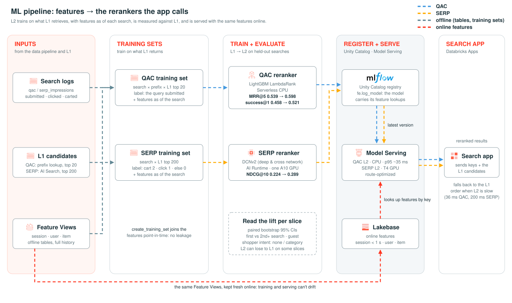

# ML pipeline (`ml/`, bundle `rts-ml`)

How the data pipeline's tables become the L2 rerankers the app calls: training sets, training, evaluation against L1,
registration and serving. For the system as a whole, see the [top-level README](../README.md); for the tables and
Feature Views this reads, see [data/README.md](../data/README.md).

Generated by `docs/make_ml_pipeline.py`; to change it, edit the script and rerun it from `real-time-search/` with
`uv run --no-project --with fonttools --with brotli python docs/make_ml_pipeline.py`.

## Jobs, in order

| Job | Task | Writes |
|---|---|---|
| `retrieval_job` | `qac_l1_lakebase` | `qac_prefix_completions` (prefix → top-k completions), synced to Lakebase |
| | `serp_l1_ai_search` | `products_search` and the AI Search hybrid index over it |
| | `query_embedding_model`, `serp_query_embedding` | GTE query embedding model (logged on Serverless GPU), served on a GPU endpoint |
| `qac_l2_job` | `qac_l2_lgbm` | Training set (search × prefix × L1 top 20), LightGBM LambdaRank, L1 vs L2 eval, registered model |
| | `qac_l2_endpoint` | Model Serving endpoint `rts-qac-l2` (CPU) |
| `serp_l2_job` | `serp_l1_candidates` | `serp_l2_searches`, `serp_l1_candidates` (hybrid top 200 per sampled search) |
| | `serp_l2_training_set` | `serp_l2_spine`, `serp_l2_matrix` (one row per search: candidates × features) |
| | `serp_l2_dcnv2` | DCNv2 on Serverless GPU (A10), L1 vs L2 eval, registered model |
| | `serp_l2_endpoint` | Model Serving endpoint `rts-serp-l2` (T4 GPU) |

## Evaluation

Both rerankers are measured against the L1 order on the test split, with paired bootstrap 95% CIs, overall and per
slice: first vs 2nd+ search in a session, guest vs logged-in, and the shopper's intent.

| Surface | Metric | L1 → L2 |
|---|---|---|
| QAC | MRR@5 | 0.539 → 0.598 (+0.059) |
| QAC | success@1 | 0.458 → 0.521 (+0.064) |
| SERP | NDCG@10 | 0.224 → 0.289 (+0.065) |

Read the slices, not just the total: QAC L2 is slightly worse than L1 when a session has no intent (MRR@5 −0.015).
The caveats and the per-slice tables are in the [top-level README](../README.md#results) and [`PLAN.md`](PLAN.md).
